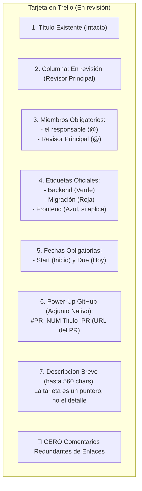

# Estándar de Entrega Automatizada: GitHub PR y Tablero Trello (AcmeOrg)

> 🏠 **Navegación:** [[Home|Home (Dashboard)]] · [[TASKS|TASKS (Registro Vivo)]] · [[docs/trello/README|Tablero Trello (export)]] · [[docs/guias/PLAYBOOK-ANTI-REGRESIONES-Y-LECCIONES-APRENDIDAS|Playbook Anti-Regresiones]] · [[docs/adr/0011-estandar-entrega-automatizada-github-y-trello|ADR-0011]]

Este documento define el procedimiento oficial y los estándares de calidad para la entrega de tareas, apertura de Pull Requests y actualización del tablero de Trello en el ecosistema **AcmeOrg Core**.

Las correcciones que tuvo esta guía, con su fecha y su motivo, están en el [Historial](#historial) al final.

---

## 0. Antes de empezar: identificar la tarjeta

La tarjeta se resuelve **al inicio del trabajo, no al final junto con el PR**. Preguntar al usuario: **¿esta tarea corresponde a una tarjeta existente, o hay que crear una?** Si existe, su título no se toca (sección 1). Si no, se propone título siguiendo la convención real del tablero — título del PR + `(repo)` — y se espera aprobación expresa antes de crearla.

> [!WARNING]
> **Consultar siempre el tablero vivo por API, nunca `docs/trello/`.** Ese directorio es un export con fecha y se desactualiza. Sirve para leer notas técnicas, no para apuntar una mutación.

> [!CAUTION]
> **Operar el tablero con la skill `/trello`** (script `.claude/tools/trello/trello.py`), no con `scripts/trello.ps1`, que no conecta en la máquina del responsable. Uso en la sección 4.

---

## 1. Regla Fundamental: Títulos y Respeto de Tarjetas

1. **Tarjetas Existentes:** Si una tarea ya cuenta con una tarjeta en Trello (ej. `API-CORE`, `Registrar un tiket y probar flujo`), **su título original se respeta al 100%** y queda prohibido renombrarla o sobrescribirla por rutina. **Excepción puntual** *(desde 2026-09-25)*: cuando el responsable pide explícitamente renombrar una tarjeta concreta (ej. estandarizar el título con el de su PR), `trello.py actualizar --titulo "..." --confirmo-renombrar` lo permite — pero solo para esa tarjeta y ese pedido, no como práctica habitual.
2. **Tarjetas Nuevas:** Solo cuando el usuario solicite explícitamente crear una tarjeta nueva, se le asignará un título descriptivo y formal.
3. **Cero Eliminaciones y Consentimiento:** Ningún agente puede mover de columna, editar descripciones, modificar miembros o adjuntar archivos sin **presentar la propuesta exacta previa y recibir la aprobación expresa del usuario**.

---

## 2. Estándar Visual de Tarjetas en Trello

**Pasar a revisión lo decide el responsable, no el PR** *(desde 2026-09-19)*. Abrir el PR no mueve la tarjeta: queda en su columna, y como mucho se le adjunta el PR (con aprobación, igual que toda mutación). Recién cuando el responsable lo pide explícitamente ("pásala a revisión") se mueve a `En revisión (Revisor Principal)` y se completan miembros y fechas; el `due` es el día en que lo pide, no el de apertura del PR. Motivo: un PR recién abierto suele necesitar todavía correcciones de bugs, y Revisor Principal no debe revisar algo que sigue cambiando.

**Checklist para pasar a `En revisión (Revisor Principal)`** *(el responsable, 2026-10-06)*. Antes de mover la tarjeta se valida todo esto; si algo falla, se corrige primero o se le avisa a el responsable:

1. **Fecha de inicio** desde que se crea la tarea (toda tarjeta nueva lleva `start`).
2. **Fecha de fin (`due`) = el día en que pasa a Revisor Principal**, y se pone recién ahí, no antes.
3. **PR adjunto** a la tarjeta: sin PR no pasa a Revisor Principal.
4. ~~**Comentario del responsable en el PR diciendo que lo revisó.**~~ *Ya no es obligatorio (el responsable, 2026-10-28).* En su lugar: 2 rondas de Codex limpias seguidas y 0 hilos abiertos.
5. **Etiquetas correspondientes** en la tarjeta (Backend, Frontend, Migración, BD, Query según lo que toque el PR).
6. **Descripciones validadas**: la del PR y la de la tarjeta dicen lo mismo, con Antes / Ahora / Qué se arregló.
7. **Títulos muy parecidos** entre el PR y la tarjeta. Si no se parecen, se avisa; el título de una tarjeta existente igual no se toca sin el OK del responsable (sección 1).

Toda tarjeta que se **entrega para revisión** del equipo debe cumplir rigurosamente con los siguientes 7 elementos. Una tarea nueva que entra al `Backlog` no está obligada a llevar miembros ni fechas: se proponen y el usuario decide, y los campos obligatorios se completan cuando pasa a revisión.



### Detalle de Campos:

| Campo | Valor / Estándar | Razón / Regla de Negocio |
| :--- | :--- | :--- |
| **Columna Destino** | **`En revisión (Revisor Principal)`** | Indica a líderes y QA que el código está en PR y listo para validación. Hay otra columna, `En revisión (Revisor Secundario)`: por eso la columna se resuelve siempre **por nombre exacto contra el tablero vivo**, nunca por un id anotado. |
| **Miembros Obligatorios** | **el responsable**, **Revisor Principal** (`@<revisor-principal>`) | **REGLA ESTRICTA:** resolver al Revisor Principal por su identificador configurado (`@<revisor-principal>`), sin confundirlo con otros colaboradores. Garantiza que Revisor Principal reciba la notificación de revisión. |
| **Etiquetas Backend** | 🟢 **`Backend`** + 🔴 **`Migración`** | Categorización oficial del tablero para tareas de API/Backend. |
| **Etiquetas Frontend** | 🔵 **`Frontend`** | Categorización oficial para tareas de `web-app`. |
| **Descripción** | **560 caracteres como máximo, sin nombres propios y sin lenguaje técnico** *(desde 2026-09-24)*: se escribe para cualquiera del equipo, programe o no. Con la misma forma que "Qué cambia" del PR *(desde 2026-09-30)*: **Antes**, **Ahora** y **Qué se arregló**, y lo que queda por decidir — nada más. Ni nombres de archivos, ni clases, ni endpoints: eso vive en el PR. Más simple aún que el PR. **No repite ni parafrasea el título** y se centra en el porqué, no en el cómo *(desde 2026-09-28)*. Al hablar de complejidad de código se dice "complejidad ciclomática", con su número y el tope de 15. Si una descripción existente pasa de 560, el texto largo se pasa a un comentario de la tarjeta y la descripción se acorta. | **La tarjeta es un puntero, no el documento.** El detalle largo vive en el PR, en el run doc o en una guía; repetirlo acá crea una segunda copia que nadie mantiene y que se desfasa de la primera. Si no entra en 560, estás escribiendo el PR dentro de la tarjeta. Ejemplo del límite bien usado: [Ejemplo de tarjeta breve (api-core)](<card-id>), 436 caracteres: objetivo, decisión y lo pendiente. |
| **Integración GitHub** | **Adjunto nativo vía Power-Up** (`#<num> <título>`) | Trello renderiza el badge de GitHub con estado del PR automáticamente. |
| **Fechas Obligatorias** | **`start` (Inicio) y `due` (Fin)** | **OBLIGATORIO al entregar:** toda tarjeta que pase a `En revisión` debe tener fechas. La fecha de fin (`due`) es **hoy a las 19:00 de la zona horaria configurada** (el día en que el responsable pide pasarla a revisión; `trello.py --vence` ya la pone a esa hora desde el 2026-09-22). Desde el 2026-10-02 el script lo impone: `actualizar --columna "En revisión (...)"` falla si la tarjeta no tiene inicio y vence. |
| **Sección Comentarios** | **LIMPIA (Sin comentarios de enlaces)** | **PROHIBIDO** pegar enlaces del PR como comentario; la integración del Power-Up es suficiente. |
| **Archivos Adjuntos** | Scripts `.sql`, diagramas, `.pdf`, ADRs | Si el cambio incluye cambios en base de datos o arquitectura, se adjuntan directamente a la tarjeta. |

---

## 3. Flujo de Apertura de Pull Request (GitHub CLI)

**`En revisión (el responsable)` es la columna previa a Revisor Principal** *(propuesta 2026-10-02, creada en el tablero el 2026-10-06 entre `En desarrollo` y `En revisión (Revisor Principal)`)*: la tarjeta vive ahí con el PR abierto mientras pasa `/supercodex` y espera el visto bueno del responsable. Pasa a `En revisión (Revisor Principal)` solo cuando el responsable lo pide, como hasta ahora. En los tableros de avance cuenta como **en curso**, no como hecho.

**La columna `En revisión (Revisor Principal)` es la cola de merges** *(desde 2026-09-22)*: Revisor Principal aprueba y mergea uno por uno en ese orden. Antes de abrir o actualizar un PR se simula la cola completa con `git merge-tree` (procedimiento en `/worktree sincronizar`, paso 7b) y el PR nuevo va **al final**. Si choca con uno de adelante, se resuelve en la rama nueva antes de que le llegue a Revisor Principal.

Todo PR debe apuntar a la rama **`develop`** y contar con una descripción concisa generada a partir del `git diff`:

```bash
# Comando de automatización con gh
gh pr create --base develop --title "fix/feat: resumen conciso" --body-file "pr_summary.md"
```

### Estructura de la Descripción del PR

Esta guía es la **dueña del formato**: la sección 9 del playbook solo fija la tipografía (sin emojis decorativos, UTF-8 sin BOM), no la estructura.

Escribe para el equipo — Revisor Principal — **asumiendo que ya dominan lo básico**. Nada de explicar cómo funcionan las migraciones de EF Core o el flujo dev/QA/PROD: eso es ruido que diluye lo que hay que revisar, y su lugar es el playbook o una guía, enlazado desde acá.

**Límite duro: 1500 caracteres** *(desde 2026-09-22; antes eran 300 palabras, que dejaban pasar cuerpos de ~1900 caracteres)*. Se cuenta con `wc -m` sobre el archivo del cuerpo **antes** de abrir el PR, y otra vez sobre el PR ya subido (`gh pr view <n> --json body -q .body | wc -m`). Referencia de uno que quedó bien: [api-core#<n>](https://github.com/<org>/api-core/pull/<n>), 517 caracteres para dos cambios. **Con margen del 10%** *(2026-09-22)*: hasta ~1650 no vale la pena recortar; el objetivo es que se lea en un minuto, no acertar un número. Lo que sí importa es no volcar el run doc adentro, que es como se llega a 1900 o más. Hasta el 2026-09-20 esto decía "debería leerse en menos de un minuto" y no alcanzó: el PR [api-core#<n>](https://github.com/<org>/api-core/pull/<n>) salió con ~700 palabras sin que nada lo frenara, porque "menos de un minuto" es una opinión y 300 palabras es un número. Lo que no entra no se comprime con prosa más densa: se va al run doc o a una guía, y se enlaza. En este orden:

1. **Qué cambia** — tres partes cortas **en lenguaje simple, como se lo contarías a alguien que no programa** *(desde 2026-09-30)*: **Antes** (cómo funcionaba y cuál era el problema), **Ahora** (cómo funciona) y **Qué se arregló** (qué deja de pasar para quien usa o mantiene el Core). Una idea por línea, sin rodeos ni explicar el cómo. Si al leerla no se entiende qué problema resuelve, está mal escrita. Sin nombres de archivos, clases, tablas ni jerga técnica. Va **arriba de todo**, no como resumen al final *(desde 2026-09-24)*. El propósito, no el changelog.
   *(El run doc cuenta la **corrida**: qué falló, qué encontró cada agente, las lecciones de proceso. El PR cuenta el **cambio**. Volcar el run doc dentro del PR es la forma más común de pasarse de las 300 palabras.)*
2. **Decisiones** — tabla `decisión → por qué`, solo para lo que no es obvio desde el diff.
3. **Qué revisar** — dónde quieres los ojos del revisor, dicho por la parte del sistema ("el cierre de registros", "la lista de plantillas"). Un archivo concreto solo si sin él no se encuentra.
4. **Pruebas** — qué corriste y el resultado, en una línea.

**Sin sección de despliegue** *(desde 2026-09-25)*. Ni orden entre PRs/repos ni pasos de migración van en el cuerpo del PR: el orden entre tarjetas lo da su posición en la columna de Trello (sección 3, cola de merges), y un paso manual real (aplicar una migración antes de desplegar, un App Setting nuevo) se registra en el run doc de la corrida, no se repite en el PR.

**El texto de "Qué cambia" se reusa tal cual como descripción de la tarjeta de Trello** *(desde 2026-09-25)*: mismo texto en los dos lados, para no escribirlo dos veces ni gastar tokens redactándolo distinto cada vez. El PR suma después lo que la tarjeta no lleva (Decisiones, Qué revisar, Pruebas); la tarjeta se queda solo con el "Qué cambia".

**Sin nombres propios y sin atribuir decisiones a personas** *(desde 2026-09-20)*. Nada de "pedido del responsable", "a pedido de", "decisión de X", ni nombres o usuarios de nadie — ni en el cuerpo del PR, ni en la tabla de decisiones, ni en los mensajes de commit que el PR muestra, ni en la descripción de la tarjeta. Va **el motivo técnico**, que es lo que el revisor puede discutir: "los canales son dato, no código: sumar uno no debería recompilar" en vez de "lo pidió Fulano". Quién decidió qué se registra en el run doc y en `TASKS.md`, que son internos; el PR es el cambio, no su historia política. Verificable antes de abrir el PR con un `grep -i` de los nombres del equipo sobre el archivo del cuerpo.

**`#N` siempre apunta al mismo repo** *(desde 2026-10-22)*. En el cuerpo, un comentario o un commit, GitHub convierte `#<n>` en link al PR 103 **del repo donde está el texto**: «igual que api-core #<n>» escrito en web-app #<n> enlazó a web-app #<n>, otro PR. No se mencionan PRs de otro repo salvo que haga falta, y entonces como `<org>/<repo>#N`. Después de abrir o editar el PR, releer el cuerpo publicado (`gh pr view <n> --json body -q .body | grep -n '#[0-9]'`) y comprobar a dónde va cada número.

### Escribir para la decisión del revisor, no para defenderse *(2026-09-22)*

Un PR de una línea salió con un párrafo explicando por qué el handle de GitHub llevaba guion y no guion bajo, qué otro colaborador se llamaba parecido, y contra qué se había verificado. el responsable lo cortó: *"solo pon handle"*.

La diferencia es a quién le habla el texto. **El revisor necesita decidir si aprueba; no necesita ver que hiciste la tarea bien.** Lo que se verificó, lo que casi sale mal y contra qué se contrastó van al run doc, que es interno. Señales de que estás escribiendo a la defensiva: "verificado contra…", "ojo que…", "a diferencia de…", explicar por qué **no** elegiste otra cosa que nadie propuso.

### Auto-revisión antes de pedir revisión *(recomendación explícita de GitHub)*

> *"Reviewing your own pull request before asking others to review it helps you catch mistakes early"* — leer el diff, buscar cambios accidentales, y confirmar que el build y los tests corrieron. — [GitHub Docs](https://docs.github.com/en/pull-requests/collaborating-with-pull-requests/getting-started/helping-others-review-your-changes)

No es simbólico: el 2026-09-22 el PR [api-core#<n>](https://github.com/<org>/api-core/pull/<n>) salió en rojo por un `INSERT` de test que nombraba una columna que la migración borraba. Leer el propio diff antes de abrirlo lo habría mostrado. Tres chequeos, todos de segundos:

```bash
git diff origin/develop...HEAD --stat          # archivos que no esperabas
git diff origin/develop...HEAD | grep -nE "^\+.*(console\.log|TODO|localhost|Debugger)"
gh pr checks <n>                                # antes de avisarle a nadie
```

### Un PR, un propósito

> *"Small, focused pull requests are easier to review and safer to merge."* Cuando el trabajo crece, *"consider splitting it into smaller pull requests that each serve one purpose."* — [GitHub Docs](https://docs.github.com/en/pull-requests/collaborating-with-pull-requests/getting-started/helping-others-review-your-changes)

El detalle —cómo medir el diff revisable, qué hacer cuando el tema es genuinamente grande— está en la **sección 21 del playbook**. Acá solo la regla: si no podés decir qué hace el PR en una frase sin "y", son dos PRs.

### Dónde mirar, cuando el PR toca muchos archivos

GitHub recomienda decirle al revisor **por dónde empezar** si el cambio cruza varios archivos o tiene un orden de lectura. Eso es la sección "Qué revisar" de arriba: no un resumen del diff, sino los dos o tres puntos donde una decisión podría estar mal.

### Lo que ya no hace falta escribir

Desde [api-core#<n>](https://github.com/<org>/api-core/pull/<n>) el repo tiene `.github/CODEOWNERS`, así que **el revisor se asigna solo**. No hace falta @mencionarlo en el cuerpo ni agregarlo a mano.

Sin emojis decorativos (rompen en terminales y en la salida de CI). Referencias a ADRs por enlace, no copiadas.

El contenido de arriba sale del run doc de la corrida (ya conciso, ya en el contexto de Claude), no de releer el diff completo — no hay delegación acá. Una lectura grande y puntual sobre un PR ya abierto (comentarios de un revisor automático, checks, un diff largo para verificar algo específico) sí puede pasar por `gh-read-shunt.sh` *(desde 2026-09-18, ver [`/shunt`](../../.claude/commands/shunt.md))*; `gh pr create`/`merge`/`close` nunca se delegan.

---

## 4. Herramienta de Automatización: skill `/trello`

La skill [`/trello`](../../.claude/commands/trello.md) opera el tablero con el script [`.claude/tools/trello/trello.py`](../../.claude/tools/trello/trello.py). Resuelve columnas, etiquetas y miembros por nombre contra el tablero vivo y relee cada tarjeta después de escribir. Además, hace cumplir por sí mismo varias reglas de esta guía: no ofrece cambiar títulos ni borrar nada, rechaza descripciones de más de 560 caracteres (no las recorta: aborta con error), resuelve el alias configurado al Revisor Principal y rechaza comentarios con enlaces de PR. Una lectura grande (`buscar` con muchos candidatos, `listar --desc`, `tablero` completo) puede pasar por `trello-read-shunt.sh` en vez de entrar cruda al contexto — los campos y el formato de la propuesta de la sección 5 no cambian, solo cómo entra una lectura grande.

Las acciones que modifican el tablero **son simulaciones salvo que se pase `--aplicar`**: la simulación imprime la propuesta de la sección 5 para mostrarla antes de tocar nada.

### Comandos Frecuentes:

```bash
# 1. Ver columnas, etiquetas y miembros del tablero vivo
python .claude/tools/trello/trello.py tablero

# 2. Buscar si ya existe una tarjeta parecida / listar una columna / ver el detalle de una
python .claude/tools/trello/trello.py buscar "palabras del titulo"
python .claude/tools/trello/trello.py listar --columna Backlog --desc
python .claude/tools/trello/trello.py ver <shortLink|URL>

# 3. Crear una tarjeta (descripcion siempre desde archivo UTF-8)
python .claude/tools/trello/trello.py crear --columna Backlog --titulo "Titulo (web-app)" --desc-archivo desc.md --etiqueta Frontend --miembro <responsable>

# 4. Entregar a revision: columna, miembros, etiquetas y fechas
python .claude/tools/trello/trello.py actualizar <tarjeta> --columna "En revisión (Revisor Principal)" --miembro <responsable> --miembro revisor-principal --etiqueta Backend --etiqueta Migración --inicio 2026-09-10 --vence 2026-09-10

# 5. Adjuntar el PR de GitHub (reconocido por Power-Up) o un archivo de soporte
python .claude/tools/trello/trello.py adjuntar <tarjeta> --url "https://github.com/<org>/api-core/pull/<n>" --nombre "#<n> feat: resumen del cambio"
python .claude/tools/trello/trello.py adjuntar <tarjeta> --archivo "api-core\docs\adr\0010-resolucion-dinamica-urls-servicios-y-politica-secretos.md"

# Cualquiera de las acciones que modifican: agregar --aplicar solo despues de la aprobacion expresa
```

---

## 4.1 Automatización: merge a `develop` mueve la tarjeta a DEV *(propuesta 2026-10-02, aún sin crear)*

Hoy la tarjeta se mueve a mano de revisión a `DEV` después del merge. La regla propuesta usa Butler, sin código ni secretos en los repos, con el PR que ya se adjunta a la tarjeta:

- **Disparador:** cuando un pull request adjunto a la tarjeta se fusiona (merge).
- **Condición:** la tarjeta está en `En revisión (Revisor Principal)` o `En revisión (Revisor Secundario)` (no en `En revisión (el responsable)`, que aún no pasó a Revisor Principal), para que un merge a `qa` o `main` no mueva nada.
- **Acción:** mover la tarjeta a `DEV`, arriba de la lista.
- **Dónde se crea:** tablero Core, menú → Automatización → Reglas → Crear automatización (`/b/<board-id>/tablero/butler/rules`). Hoy no hay reglas creadas.

**Estado:** sin crear. El 02/10 el editor de reglas quedó cargando (rueda sin fin) en tres intentos, incluso tras recargar, así que no se pudo ver si el disparador "PR fusionado" existe en nuestro plan. Pendiente reintentar a mano; al crearla, borrar esta línea de estado y anotar la fecha en el Historial.

**Alternativa si Butler no ofrece el disparador:** un workflow de GitHub Actions por repo, en `pull_request: closed` con `merged == true`, que lea el id de la tarjeta de la línea `Tarjeta:` del PR y llame a la API de Trello. Pide la key y el token de Trello como secrets en cada repo, por eso la decide el responsable. Mismo límite de rama: solo PRs contra `develop`.

La tarjeta sigue pasando a revisión solo cuando el responsable lo pide (sección 2); esta regla solo cubre el paso de revisión a `DEV` al hacer merge.

---

## 5. Plantilla de Propuesta Obligatoria para el Agente

Antes de ejecutar cualquier cambio en Trello, el agente DEBE presentar al usuario esta plantilla y esperar confirmación. La simulación de `/trello` imprime estos campos ya resueltos contra el tablero:

```markdown
📋 **Propuesta de Entrega para Trello:**
- **Tarjeta:** [Nombre de la tarjeta] (ID: `XYZ`) [Título intacto]
- **Columna destino:** En revisión (Revisor Principal)
- **Etiquetas:** Backend, Migración
- **Miembros:** el responsable, Revisor Principal (`<revisor-principal>`)
- **Fechas:** inicio AAAA-MM-DD, vence AAAA-MM-DD (hoy)
- **GitHub PR:** #<Num> [Título del PR]
- **Adjuntos de archivos:** [Lista de archivos si aplica, o Ninguno]
- **Descripción:**
  [Resumen con viñetas]

¿Confirmas para proceder a actualizar Trello?
```

---

## Historial

Correcciones de esta guía, de la más reciente a la más vieja. Se sacaron del cuerpo para que las reglas se lean limpias; el motivo de cada una se conserva acá.

- **2026-10-06 — Columna `En revisión (el responsable)` creada y checklist para pasar a Revisor Principal.** el responsable pidió que todo lo listo pase primero por su revisión, y que antes de pasar a Revisor Principal la tarjeta tenga inicio desde su creación, fin el día del pase, PR adjunto, su comentario de revisado en el PR, etiquetas, descripciones validadas y títulos parecidos entre PR y tarjeta. Las 5 tarjetas que estaban con Revisor Principal volvieron a `En revisión (el responsable)`.
- **2026-09-30 — "Qué cambia" y la descripción de la tarjeta pasan a Antes / Ahora / Qué se arregló.** Las descripciones seguían siendo poco claras y daban vueltas sin decir qué problema resolvía el cambio. Con tres partes fijas se ve de una vez cómo era, cómo es y qué mejora.

- **2026-09-25 — Sin sección de despliegue en el PR; "Qué cambia" se reusa como descripción de la tarjeta.** Varios PRs traían una sección "Orden de despliegue" explicando en qué orden aplicar migraciones o desplegar repos juntos — eso duplicaba lo que ya dice la posición de la tarjeta en la cola de Trello, y un paso de migración real se pierde de vista si vive solo en el PR (que se cierra y ya no se mira) en vez del run doc. Se sacó la sección entera. De paso, varios PRs abiertos tenían nombres de archivo y de clase en "Qué cambia" (contra la regla del 2026-09-24 de abajo, que ya lo prohibía pero no se venía cumpliendo): se corrigieron y se fijó que ese texto es el mismo que va en la tarjeta, para no reescribirlo dos veces.
- **2026-09-20 — Fuera los nombres propios del PR y de la tarjeta.** La tabla de decisiones del PR api-core#<n> justificaba una fila con "Pedido del responsable". el responsable: *"nunca pongas pedido del responsable, así los nombres, o sea no referencia a nombres... solo pon lo que se hizo"*. Una decisión atribuida a una persona no se puede discutir en la revisión; un motivo técnico sí. El registro de quién decidió qué sigue existiendo, pero en el run doc y en `TASKS.md`, que son internos.
- **2026-09-20 — La descripción del PR pasa a tener un límite contado: 300 palabras.** Antes la regla era "debería leerse en menos de un minuto", y el PR [api-core#<n>](https://github.com/<org>/api-core/pull/<n>) salió igual con ~700 palabras: tenía las 5 secciones correctas, pero cada una con el detalle del run doc adentro. el responsable: "el texto siempre se debe poder leer en 1 min a 1 min y medio, mucho texto". Un umbral que se cuenta con `wc -w` no depende de que quien escribe calcule bien cuánto tarda en leerse su propio texto.
- **2026-09-19 — La tarjeta pasa a revisión solo cuando el responsable lo dice.** Antes, abrir el PR disparaba la propuesta de mover la tarjeta a `En revisión (Revisor Principal)`. Pero los PRs recién abiertos seguían recibiendo correcciones de bugs, y Revisor Principal quedaba revisando algo a medio cerrar. Desde ahora, con el PR abierto solo se ofrece adjuntarlo; mover la tarjeta, sumar a Revisor Principal y poner fechas espera el pedido explícito del responsable.
- **2026-09-11 — Precisiones de la auditoría del vault.** La sección 4 decía que el script "corta" las descripciones largas: `validar_descripcion` en `trello.py` las rechaza con error, no las recorta. El ejemplo de `adjuntar --archivo` usaba un nombre abreviado del ADR 0010 que no existe; se puso el nombre real.

- **2026-09-10 — Límite de la descripción: de menos de 490 a 560 como máximo.** Pedido del responsable al actualizar la tarjeta de degradación de la Vista agregada, que con datosExternos resuelto y tres huecos de relaciones quedaba en el borde. Las tarjetas escritas con el límite anterior siguen siendo válidas.

- **2026-09-10 — Skill `/trello` y aclaración sobre Backlog.** La sección 4 documentaba `scripts/trello.ps1`, que no funciona en la máquina del responsable (ver 2026-09-08), y cada operación terminaba en Python escrito a mano. Se reemplazó por la skill `/trello`. Se aclaró además que miembros y fechas obligatorios aplican al **entregar a revisión**: ese día el responsable pidió crear una tarea en Backlog sin Revisor Principal como miembro. Las notas fechadas que había en medio del texto se movieron a este historial.
- **2026-09-09 — Límite de la descripción: de 330 a 490 caracteres.** Regla del responsable del mismo día: empezó en 330 y la subió a 490 al ver que quedaba corto para hallazgos con evidencia. Las tarjetas creadas bajo el límite viejo siguen siendo válidas; no hay que reescribirlas. Mismo día y mismo criterio para el PR: la descripción entera se lee en menos de un minuto.
- **2026-09-08 — `scripts/trello.ps1` no funciona en la máquina del responsable.** `Invoke-RestMethod` y `curl` usan schannel, la pila TLS de Windows, y el handshake contra `api.trello.com` se cae con `schannel: failed to receive handshake, SSL/TLS connection failed`, mientras `api.github.com` responde 200 desde el mismo shell. Python usa OpenSSL y conecta sin problema. Las credenciales viven en `~/.trello-credentials.json`, que es **UTF-8 con BOM**: hay que abrirlo con `encoding='utf-8-sig'` o `json.load` falla con `Expecting value: line 1 column 1`.
- **2026-09-08 — La columna `En revisión` se partió en dos.** Quedaron `En revisión (Revisor Principal)` (`<list-id>`) y `En revisión (Revisor Secundario)`. El id que esta guía traía (`<list-id>`) pasó a apuntar a la de **Revisor Secundario**: usarlo mandaba la tarjeta a la columna equivocada. De ahí la regla de resolver columnas por nombre contra el tablero vivo.
- **2026-09-08 — `docs/trello/` no es fuente de verdad.** Ese export listaba una columna `En revisión` que ya no existía, y su columna de IDs tenía colisiones: dos pares de tarjetas distintas compartiendo el mismo identificador.
- **2026-09-08 — Sección 0 agregada.** La tarjeta se resuelve al inicio de la corrida y no al final: ese día se llegó al PR abierto y recién ahí se buscó la tarjeta, contra un export de doce días que mentía en columnas e IDs.
